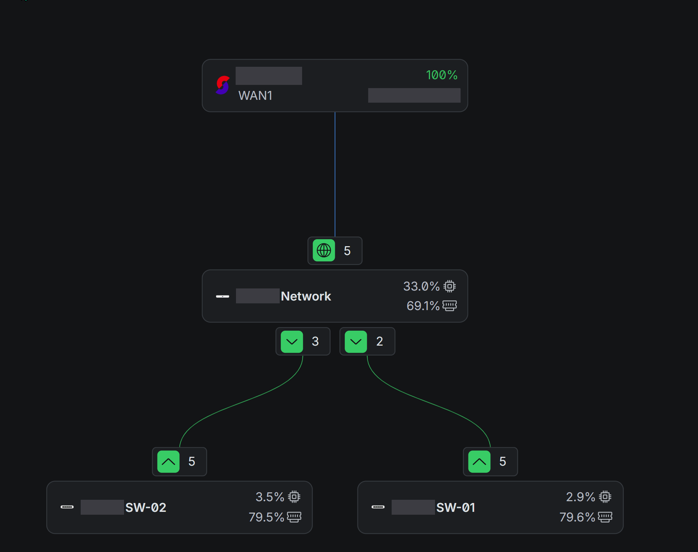
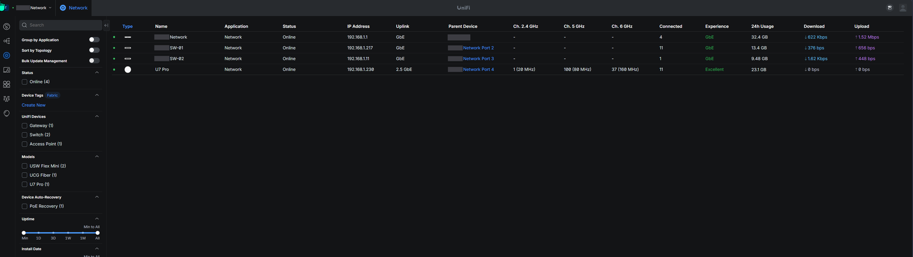
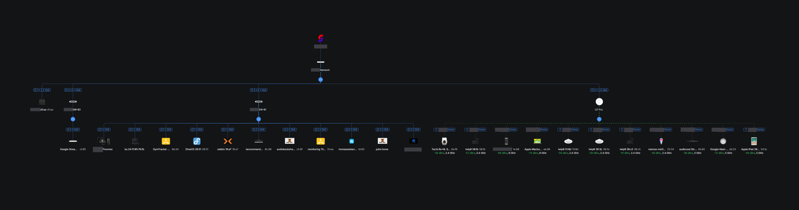

# UniFi Home Network

The network behind the homelab: a **UniFi Cloud Gateway Fiber**, two **USW Flex Mini** switches and a **U7 Pro** Wi-Fi 7 access point, in a 10" rack with a CAT6 patch panel. It hands out the two Pi-hole DNS servers, gives remote access through WireGuard, and is monitored by Zabbix (SNMP) and Prometheus (UniFi Poller).



---

## Hardware



| Device | Model | Role |
|---|---|---|
| Gateway | **UCG Fiber** | Router, firewall, DHCP, WireGuard VPN server, controller. 2.5 GbE ports, 10G SFP+ |
| Switch 1 | **USW Flex Mini** (5× 1 GbE) | Servers: both Proxmox nodes, the backup server |
| Switch 2 | **USW Flex Mini** (5× 1 GbE) | Media: TV streamer and spare ports |
| Wi-Fi | **U7 Pro** (Wi-Fi 7, 2.4/5/6 GHz) | Powered by PoE+ from the gateway, 2.5 GbE uplink |
| Patch panel | CAT6 | Every cable lands on the panel; short patch leads to the switches |

## Layout



```
ISP (fibre/HFC modem) ── UCG Fiber ─┬─ port 1 (2.5 GbE)  desktop PC
                                    ├─ port 2 ── SW-01 ── pve1, pve2, backup server
                                    ├─ port 3 ── SW-02 ── TV streamer
                                    └─ port 4 (2.5 GbE, PoE+) ── U7 Pro ── ~15 Wi-Fi clients
```

Everything is on one flat LAN (the "Default" network). The homelab is small and every device is mine, so I chose simplicity over VLANs for now (see roadmap).

## Settings worth noting

| Area | Setting | Why |
|---|---|---|
| **DHCP DNS** | DNS 1 = Pi-hole 1, DNS 2 = Pi-hole 2 | Network-wide ad blocking with failover ([pihole-ha-dns](https://github.com/nashibbhattrai766-max/pihole-ha-dns)) |
| **Content filtering / Ad Block** | **Off** | It transparently intercepts all port-53 DNS and broke Pi-hole's recursive resolver. Pi-hole does this job now |
| **DHCP reservations** | Every server, VM and container | Fixed addresses for monitoring and DNS |
| **SNMP** | v2c enabled (read-only community) | Zabbix polls interfaces, traffic and uptime ([zabbix-monitoring](https://github.com/nashibbhattrai766-max/zabbix-monitoring)) |
| **UniFi Poller** | Runs in the monitoring container, exports to Prometheus on `:9130` | Client counts, Wi-Fi signal, top talkers and gateway load on the rack screens ([grafana-rack-dashboards](https://github.com/nashibbhattrai766-max/grafana-rack-dashboards)) |
| **Firmware updates** | Applied by UniFi overnight | Expect a short "AP down" alert in the early morning when a device updates |

## Remote access: WireGuard VPN

The gateway's **One-Click VPN** (WireGuard) gives phones and laptops access to the home LAN from anywhere:

- VPN subnet separate from the LAN; one client profile per device (QR code for phones).
- **Split tunnel**: only LAN traffic goes over the VPN, so the GymTracker app, Home Assistant and the admin UIs work from outside without routing all internet traffic home.
- **Nothing is port-forwarded.** All admin UIs and apps are reachable only on the LAN or over the VPN.
- The WAN IP is dynamic, so a client profile breaks if it changes. Setting up **Dynamic DNS** and using the hostname as the VPN's alternate address is on the roadmap.

## Roadmap

- Separate **VLANs** for servers, IoT devices and guests, with firewall rules between them
- Move IoT devices (bulbs, plugs, kettle) off the main LAN
- Dynamic DNS for the VPN endpoint

## License

MIT
